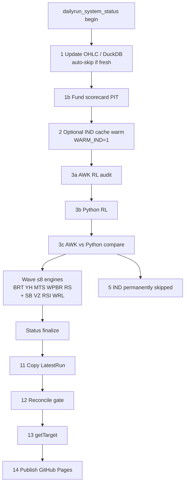
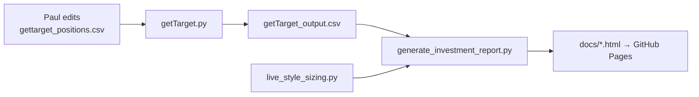

# TBN architecture

**Twin Beacon Networks (TBN)** is the equities research + live-ops platform:
nightly backtests across many sleeves, an open-book stop/target layer, and
GitHub Pages reports. This document is the canonical map as of **2026-11-06**.

Related product repos (split out of the old `stockresearch` monorepo):

| Repo | Path | Owns |
|------|------|------|
| **TBN** (this) | `C:\Users\songg\code\TBN` | DailyRun, engines, Pages, OHLCV |
| **PredictionsMarkets** | `C:\Users\songg\code\PredictionsMarkets` | Kalshi/Poly/Gemini/Novig kitchen |
| **Spotify** | `C:\Users\songg\code\Spotify` | playlist / listen tooling |

Split kit: [`repo_split/README.md`](../repo_split/README.md).
Setup: [`SETUP_NEW_PC.md`](../SETUP_NEW_PC.md).
Naming: [`TBN_VS_BRT.md`](TBN_VS_BRT.md).

---

## 1. What TBN is (and is not)

**Is**

- A shared backtest **engine** (`stock_analysis/rocket_tbn.py`) hosting many
  strategy systems behind `run_*.bat` wrappers.
- A **DailyRun** orchestrator that refreshes data, runs wired sleeves (often in
  a parallel wave), gates Closed CSVs, sizes live exits, and publishes Pages.
- An **open-book** workflow: Paul edits `gettarget_positions.csv`; getTarget +
  the investment report turn that into stops/targets/Suggested shares.
- A **report surface** under `docs/` deployed via GitHub Pages
  (`pauljanderson/TBN_Report`).

**Is not**

- A broker auto-trader. Fills and sells stay human / mobile inbox.
- The prediction-market kitchen (moved to PredictionsMarkets).
- Walk-forward “gold” for every DailyRun sleeve. Several sleeves are
  preference-adopt / official mix — see system write-ups.

---

## 2. High-level layout

```
TBN/
  DailyRun.bat                 Nightly orchestrator
  run_*.bat                    Per-system / per-tool launchers
  getTarget.py                 Live stop/target for open book
  generate_*_report.py         Pages report generators
  stock_analysis/              Engines, OHLCV, sizing, optimizers
  tools/                       Research A/Bs, gates, helpers (~700+ files)
  scripts/                     DuckDB build, Pages publish, scanners
  docs/                        GitHub Pages site + long-form docs
  data/                        OHLCV CSVs + ohlcv.duckdb (gitignored)
  drive/                       Run outputs, universes, freezes (gitignored)
  local/                       Machine-local scratch (gitignored)
  secrets/                     Credentials (gitignored; TBN rarely needs PM keys)
  logs/                        DailyRun_*.log
  repo_split/                  One-time monorepo → three-repo migration kit
  tos/                         Thinkorswim helpers
```

**Authority rules**

| Concern | Source of truth |
|---------|-----------------|
| Which systems DailyRun runs | `DailyRun.bat` + `tools/dailyrun_system_status.py` `DAILYRUN_REGISTRY` |
| Open system lots | `gettarget_positions.csv` (Paul-edited) |
| Live stops/targets | `getTarget_output.csv` (written only by `getTarget.py`) |
| Live Suggested shares | `stock_analysis/live_style_sizing.py` (+ account JSON under `drive/`) |
| Per-symbol BRT/RL params | `stock_analysis/Per_Symbol_Optimized_Settings_Approved_Latest.json` |
| RL math | AWK `portfolio_audit.awk` (Python RL must parity via `run_rl_compare`) |
| Price warehouse | `data/newdata/data/*.csv` upserted by `pygetallMore`; DuckDB mirror `data/ohlcv.duckdb` |
| Frozen experiment evidence | `drive/paul_experiments/<stamp>/` |

---

## 3. DailyRun pipeline

Entry: `DailyRun.bat` (Task Scheduler or manual). Always `cd /d "%~dp0"` so the
repo can live at `code\TBN` (or anywhere).

CLI: `DailyRun.bat [-w N|--workers N] [--noGet|--no-get]`



### Step table (labels are historical `n/13`; publish is `14/14`)

| Step | Action | Skip / notes |
|------|--------|----------------|
| 1 | `run_update_data.bat` → `pygetallMore` | Auto-skip when `tools/data_update_freshness.py` says fresh; `SKIP_GET=1` / `FORCE_GET=1` |
| 1b | `run_fund_scorecard_refresh.bat` | `SKIP_FUND_SCORECARD=1` |
| 2 | `run_warm_indicator_cache.bat` | Off unless `WARM_IND=1` |
| 3a–c | AWK RL → Python RL → compare | Hard fail if parity fails |
| 4 | BRT (wave) | |
| 5 | IND | **Deprecated — always skipped** |
| 6–9 | YH, MTS, WPBR, RS (wave) | |
| 10 / 10b–d | SB, VZ, RSI, WRL (wave) | `SKIP_SB` / `SKIP_VZ` / `SKIP_RSI` / `SKIP_WRL` |
| 11 | `run_copy_latest.bat` | Promote stamped runs → `*_LatestRun_*` |
| 12 | `run_reconcile_gate.bat` | Frozen Closed vs latest; `SKIP_RECONCILE_GATE=1` |
| 13 | `run_gettarget.bat` | Empty book exits 0 (clears output) |
| 14 | `publish_github_pages.bat --push` | Fetch/rebase `origin/main` then push Pages |

**Not in DailyRun (standalone):** options chain archive, intraday 1m fetch,
trendlines daily / TOS (still mentioned in some DailyRun comments — see tech debt),
post-run deep charts, research A/B bats.

Wave runner: `tools/dailyrun_wave.py` — at most 8 system engines; waits if CPU
load &gt; 90%. Engines that take `-w` inherit `DAILYRUN_WORKERS`.

Logs: `logs/DailyRun_yyyyMMdd_HHmmss.log`.

---

## 4. System roster

Write-ups: [`docs/systems/index.html`](systems/index.html).

### DailyRun-wired (live)

| Code | Name | Launcher | Notes |
|------|------|----------|-------|
| **RL** | Rocket Launcher | `run_audit` + `run_rl` + compare | AWK authoritative; Python must match |
| **BRT** | Break and ReTest | `run_brt.bat` → `rocket_tbn.py` | Per-symbol approved JSON |
| **YH** | Year High | `run_yh.bat` | |
| **MTS** | Magic Touch | `run_mts.bat` | Official 6-sys sleeve member |
| **WPBR** | Weekly Pivot Break/Retest | `run_wpbr.bat` | Freeze 2026-10-02 (overhead 22%, tgt 1.20, stop 0.92) |
| **RS** | Relative Strength vs SPY | `run_rs.bat` | Needs Trend Condition indicators |
| **SB** | StockBee Momentum Burst | `run_sb.bat` | Gold univ `drive/universes/SB_universe.csv` (56) |
| **VZ** | Volume Zone | `run_vz.bat` | Paul78.142; one position per symbol; not gold |
| **RSI** | Relative Strength Index | `run_rsi.bat` | Not RS-vs-SPY; preference-adopt; not gold |
| **WRL** | Weekly Range / Swing | `run_wrl.bat` | 29-name house; official 6-sys; not gold |

**Official 6-sys live-style compound sleeve:** SB / RSI / VZ / MTS / RL / WRL.
Live Suggested shares still size **every** getTarget system (plus book-guard).

### Retired / deprecated / research

| Code | Status |
|------|--------|
| **IND** | Deprecated — DailyRun step permanently skipped; still appears on some historical reports |
| **MVCP** | Retired 2026-08-21 from DailyRun + active reporting; `run_mvcp.bat` research only |
| **MOM**, **QULL**, **KELL**, **CS**, **PBR**, **VEC**, … | Research / not wired (`LIVE_EXCLUDE` in status module) |

Adding a new live sleeve: (1) `run_*.bat` step in `DailyRun.bat`, (2) entry in
`DAILYRUN_REGISTRY` + `REPORT_ORDER`, (3) system write-up, (4) reconcile coverage
if Closed stamps matter.

---

## 5. Engine architecture

```
run_brt.bat / run_rl.bat / …
        │
        ▼
stock_analysis/rocket_tbn.py     Shared host (zones, RL mode, RS, …)
        │
        ├── CSV or DuckDB prices (ohlcv_store)
        ├── Indicator / TC cache (.brt_indicator_cache)
        ├── Per-system -v / CLI profiles (frozen in bats)
        └── Writes drive/{PREFIX}_Closed|Open|Scanner|Watchlist|Summary_<ts>.*
```

- Legacy shim: `rocket_brt.py` → TBN host (keep BRT naming on outputs).
- Standalone engines (SB burst, Qull, Kell, CAN SLIM, …) live beside the host
  and are only DailyRun-wired when their `run_*.bat` is listed above.
- Post-run enrichments (FIT, ImproveHints) attach after Summary write —
  see [`POST_RUN_ANALYSIS.md`](POST_RUN_ANALYSIS.md). Deep charts are **not**
  part of DailyRun.

---

## 6. Data plane

| Path | Role |
|------|------|
| `data/newdata/data/{SYM}.csv` | Canonical daily OHLCV (2010+ target) |
| `data/ohlcv.duckdb` | DuckDB `prices` mirror for fast loads / wave reads |
| `data/intraday/1m/` | Research 1m parquet — **not** DailyRun ([`INTRADAY_1M.md`](INTRADAY_1M.md)) |
| `drive/*_LatestRun_*` | Promoted watch/scan/open for reports |
| `drive/{SYS}_profile.duckdb` | Per-system timing / profile DBs |
| `drive/universes/*.csv` | House universes (SB, VZ, RSI, WRL, …) |
| `drive/fundamentals_cache.duckdb` | Yahoo EPS / short interest |
| `drive/fund_scorecard_latest/` | PIT fund scores |
| `drive/paul_experiments/` | Freeze stamps + adopt notes |
| `drive/live_style_account.json` | BOM / current equity for sizing |
| `yfinance_cache.json` | Quote cache at repo root |

Update path: `run_update_data.bat` → `stock_analysis/pygetallMore.py` (also
refreshes fundamentals on a TTL unless skipped).

---

## 7. Open book → live ops → Pages



| File | Role |
|------|------|
| `gettarget_positions.csv` | Authoritative open **system** lots (symbol, date, entry, system) |
| `personal_holdings_exclude.csv` | Personal / non-system names to hide from Open |
| `sold_symbols_blocklist.csv` | Permanently hide until removed + re-added to gettarget |
| `trade_system_registry.csv` | Extra lot/system hints for the report |
| `getTarget_output.csv` | Computed Target/Limit/CurrentPrice (never overwrites positions) |
| `closed_positions_log.csv` | Manual closed log feed |

**Empty book is valid:** header-only `gettarget_positions.csv` → getTarget clears
`getTarget_output.csv` and exits 0 so DailyRun can finish
(`tools/test_gettarget_empty_book.py`).

**Live sizing freeze** (`live_style_sizing.py`): 1% equity risk capped at $50k,
1% ADV20, 17.5% name cap; **book-guard** overlay $25k notional / max 8 names /
gross long ≤ equity. Engine Closed CSVs keep house dummy notionals for reconcile.

Publish: `scripts/publish_github_pages.py` regenerates investment / monthly /
convergence / performance / live-style pages into `docs/` and can `--push` to
`origin/main` (Pages source).

---

## 8. Reconcile and status

- **Reconcile gate** (`run_reconcile_gate.bat`): fails DailyRun if latest Closed
  drifts from frozen baselines for covered systems. Docs under
  `drive/paul_experiments/yh_baseline_20260731/RECONCILE_GATE.md`.
- **System status JSON** (`drive/DailyRun_systems_status.json`): RUN / SKIPPED /
  NOT WIRED / STALE / MISSING chips on the investment report.
- **Copy latest** must run before reconcile/publish so `*_LatestRun_*` match the
  night’s stamps.

---

## 8b. Research honesty, portfolio risk, governance (added 2026-11-12)

Three layers added after the 2026-11-11 review (live May–Nov 2026: −$219K on 158
trades; edges decayed after every freeze).

**Honest backtest harness** — `tools/honest_bt/`

| File | Role |
|------|------|
| `fetch_pit_daily.py` | Survivor-free daily OHLCV from Alpaca (active + delisted, 2016+) → `data/pit_daily/` |
| `pit_universe.py` | Mechanical point-in-time universe: 60-bar median close ≥ $5, $vol ≥ $10M, ≥200 bars, decided on the prior month's last bar |
| `run_honest.py` | Runs each production `run_*.bat` unchanged on ALL symbols with `TBN_DATA_DIR` / `TBN_OUT_DIR` / `TBN_NO_DUCKDB=1`; outputs only under `drive/honest_bt/<stamp>/`; preflight + drive-root guard refuse/abort if production files would be touched |
| `score.py` | Same yardstick for every variant: entries ≥ 2019, 10 bps/side, month-clustered t, multiple-testing bar √(2 ln trials) → `scorecard.csv/json` |

The `run_*.bat` launchers default `TBN_DATA_DIR=data\newdata\data`, `TBN_OUT_DIR=drive`
(production command lines verified byte-identical, 2026-11-12).

**Portfolio risk** — `stock_analysis/portfolio_risk.py` (freeze `portfolio_risk_v1_20261112`).
One view across every system: heat (loss if every stop hits) ≤ 5% of equity, −2% day /
−6% month-to-date halts, average correlation / effective bets. Feeds
`allot_scan_buys(risk_halt_reason=, max_new_buys=)`: a breach turns every new trigger into
`NONE (risk halt)`. Fails closed. Panel on investment.html; `drive/portfolio_risk_latest.json`.

**Governance** — `governance/production_lock.json` + `governance/ADOPTIONS.csv` (tracked).
Every production knob (wired launchers, their universes, per-symbol JSON, sizing + risk limits)
is fingerprinted (CRLF-insensitive). An unadopted change halts **new buys** (DailyRun still
runs, stops still publish). The only way to move the lock is `tools/adopt.py`: requires a PIT
`PASS` from the harness and fits the budget (1 change/system/quarter, 3 total) or a recorded
`--override`. `python tools/adopt.py --check` shows drift.

---

## 9. Reports and docs map

### Operator / architecture (keep current)

| Doc | Purpose |
|-----|---------|
| [`ARCHITECTURE.md`](ARCHITECTURE.md) | This map |
| [`../SETUP_NEW_PC.md`](../SETUP_NEW_PC.md) | Machine setup + Task Scheduler |
| [`../DUCKDB_SETUP.md`](../DUCKDB_SETUP.md) | Build / use OHLCV DuckDB |
| [`../FIX_STOCK_ANALYSIS.md`](../FIX_STOCK_ANALYSIS.md) | Nested-gitlink recovery |
| [`TBN_VS_BRT.md`](TBN_VS_BRT.md) | Engine vs BRT system naming |
| [`POST_RUN_ANALYSIS.md`](POST_RUN_ANALYSIS.md) | FIT / hints / optional charts |
| [`RL_ENGINE_INTEGRATION.md`](RL_ENGINE_INTEGRATION.md) | RL port + AWK authority |
| [`INTRADAY_1M.md`](INTRADAY_1M.md) | Research 1m store |
| [`systems/index.html`](systems/index.html) | Per-system write-ups |
| [`trendlines/README.md`](trendlines/README.md) | Trendline chart pipeline |
| [`../repo_split/README.md`](../repo_split/README.md) | Monorepo split |

### Generated Pages artifacts (overwrite on publish)

`docs/investment.html`, `monthly.html`, `convergence.html`,
`system_performance.html`, `live_style*.html`, `open_today.html`,
`trendlines/index.html`, system HTML under `docs/systems/`, etc.

`docs/index.html` is often a **stale scanner-open snapshot** until publish
rewrites the landing set — treat investment / systems / philosophy as the
human entry points, not necessarily `index.html`.

### Research / historical (do not treat as runbook)

`AGGRESSIVE_MODE.md`, `HYPOTHESIS_TEST.md`, `TRAILING_STOPS.md`,
`IND_EARLY_SIGNAL_ANALYSIS.md`, `docs/research/*`, root `BRT_vs_Manual_Comparison.md`,
`stock_analysis/BRT_*` analysis notes.

---

## 10. Runtime and ops

- **Python:** 3.10 from python.org under `%LOCALAPPDATA%\Programs\Python\...`
  (Store builds break Task Scheduler). Resolver: `resolve_python.bat`.
- **Deps:** `requirements.txt` (numpy, pandas, yfinance, duckdb, matplotlib, …).
- **Remote:** `https://github.com/pauljanderson/TBN_Report.git` (Pages on `main`).
- **Preferred install path:** `C:\Users\songg\code\TBN`. Legacy twin
  `Downloads\stockresearch` may still exist during migration — **one** tree
  should own Task Scheduler.
- **Cursor:** open `code\TBN` for this product; PredictionsMarkets / Spotify are
  separate chats/repos.

---

## 11. Recommended changes

Prioritized for health of DailyRun and docs truthfulness.

### P0 — stop dual-running / path drift

1. **Own local `data/` + real `drive/` under `code\TBN`.** (Done 2026-11-06:
   junction removed; ~82GB robocopy materialize; warehouse synced to 11-06.)
   Still required once (elevated): `tools\fix_tbn_task_scheduler_startin.ps1`
   so Task Scheduler “Start in” is `C:\Users\songg\code\TBN` (was Downloads —
   access denied without admin). Then archive the Downloads twin. Freshness
   compares SPY.csv + ohlcv.duckdb max dates to the expected session and
   requires `stamp.data_root` to match this tree (`tools/data_update_freshness.py`).
2. **Finish hardcoded-path cleanup.** Repo-relative now (2026-11-06):
   `pygetallMore.py`, `getTarget.py` `DEFAULT_DATA_DIR`,
   `generate_investment_report.py` `DEFAULT_OHLCV_DATA_DIR`. Logo/showcase still
   optionally fall back to `Downloads\` filenames. Dozens of `tools/_*.py`
   research one-offs still hardcode `Downloads\stockresearch` — rewrite or
   archive. Audit: `python repo_split\lib\rewrite_paths.py --root … --audit-only`.
3. **Pages landing:** `docs/index.html` is the **scanner-open report** by design
   (`publish_github_pages.py`). Prefer investment / systems / philosophy as the
   human hub until a deliberate landing redesign.
4. **Finish prune of Predictions / Spotify leftovers** in this tree (orphaned
   `tools/test_*poly*`, `docs/prediction_market/` HTML, deleted bats still in
   git status). `run_all.bat` (legacy) moved to `archive/root_oneoffs/` 2026-11-12.

### P1 — pipeline honesty

5. **Renumber DailyRun steps** (drop fake `/13` and `14/14`) or document the
   label scheme once in the bat header and stop inventing new fractions.
6. **Trendlines comments** in DailyRun help were cleared 2026-11-06; keep bats
   standalone (`run_trendlines_daily.bat` / `run_trendlines_tos_daily.bat`).
7. **Keep `DAILYRUN_REGISTRY` and system write-ups** as the only sleeve lists;
   regenerate `docs/systems/*` via `tools/_gen_system_writeups.py` when freezes
   change.

### P2 — architecture simplifications

8. **RL: plan AWK retirement** once Python parity is trusted enough for a
   soft-compare period, then hard-cut DailyRun to Python-only (today compare is
   load-bearing).
9. **DuckDB as default read path** for all wave engines; keep CSV as rebuild
   source. Document Windows single-writer lock rules next to wave jobs.
10. **Collapse duplicate launchers** (`run_all.bat` vs DailyRun, etc.) to one
    canonical name each.
11. **Open-book automation:** optional post-Fidelity import that proposes
    gettarget adds/prunes (human confirm) so empty/stale books are rarer.

### P3 — product clarity

12. **Optional Pages hub redesign** — only if you want `index.html` to stop
    being the scanner-open report (requires `publish_github_pages.py` change).
13. **Mark gold vs official vs research** consistently on investment chips and
    write-ups (WRL/VZ/RSI already say “not gold” — surface that in one legend).

---

## 12. Tech debt register

| ID | Debt | Risk | Pay-down |
|----|------|------|----------|
| TD-01 | Dual trees (`code\TBN` ↔ `Downloads\stockresearch`) | Nightly job hits stale code (e.g. empty-book raise) | Single Task Scheduler root; delete/archive twin |
| TD-02 | Hardcoded absolute paths (engines mostly fixed; many `tools/` one-offs remain) | Wrong data root on new PC / dual tree | Relative paths + audit script in smoke |
| TD-03 | Nested `stock_analysis` gitlink history (`.git_nested_backup`) | Empty clone of engines | Keep `FIX_STOCK_ANALYSIS.md`; ensure remote tracks files |
| TD-04 | ~34 `tmp_wpbr_*` (and similar) experiment dirs in repo root | Disk noise; confuse agents | 2026-11-12: 30 unreferenced root one-offs moved to `archive/root_oneoffs/` (git mv) |
| TD-05 | `tools/` sprawl (700+ files, many one-off A/Bs + leftover PM tests) | Hard to find gold tools | 2026-11-12: 104 unreferenced `tools/_*.py` → `tools/archive/oneoffs/`, 4 PM tests → `tools/archive/pm_leftovers/` |
| TD-15 | Survivorship + in-sample universes (warehouse = today's survivors; RSI/VZ/BRT/SB lists picked on IS results) | Backtests overstate edge | Judge only on `tools/honest_bt` PIT scorecard; adopt via `tools/adopt.py` |
| TD-16 | `rocket_tbn.py` monolith (22.8k lines, 504-field config, 3.7k-line `run_brt_backtest`) | Every idea is another flag | Split per system, one verified slice at a time (identical trade outputs). Slice 1 done 2026-11-12: `BRTConfig` -> `stock_analysis/tbn_config.py` (re-exported; 40-symbol before/after on 9 systems, all Closed/Open/Watchlist/Pivots identical) |
| TD-17 | Equity curve / EquityMeta / Correlation / ImproveHints differ run-to-run on identical inputs (trade rows arrive in parallel-completion order; same-day ordering feeds the portfolio sim) | Reported CAGR/DD wobble ~0.5pt between identical runs; refactor checks must compare trade files, not these | Stable-sort trades by (entry date, symbol) before the equity sim |
| TD-18 | **Look-ahead in the WPBR overhead skip**: `prior_overhead_zone_count` counts a zone from `activation_bar` (its pivot week's Monday), but a weekly pivot is only known 3 weeks later; the backtest skips the trades whose overhead high later held | WPBR backtest +2.84%/trade PASS → +0.77% WEAK without it; live takes the trades the backtest skipped. WPBR moved to paper 2026-11-13 (`drive/honest_bt/20261113/overhead_lookahead`) | Born = confirmation bar (or causal pivot-so-far). Class guard: `tools/honest_bt/truncation_test.py` (cut data, pre-cut trades must not change) before any adoption |
| TD-06 | AWK + Python RL dual stack | Double runtime; compare flakes | Soft-compare → Python-only |
| TD-07 | DailyRun step labels vs reality (trendlines comments, 13/14 mix) | Operators mis-debug | Fix bat comments + this doc |
| TD-08 | Stale operator docs (Task Scheduler path, DailyRun step list, WRL “not DailyRun”, TRAILING_STOPS steps) | Bad setups | Updated 2026-11-06 — keep in sync with bat |
| TD-09 | `docs/index.html` is scanner-open (by publish design) | Confusing if mistaken for doc hub | Documented; optional redesign is P3 |
| TD-10 | `requirements.txt` still lists Spotify deps | Misleading installs | Trim to TBN runtime |
| TD-11 | IND/MVCP ghosts in reports and sizing sets | Noise / false “active” signal | Keep wired=False; eventually drop from REPORT_ORDER extras |
| TD-12 | DuckDB Windows lock vs parallel wave | Rare wave failures | Read-only opens + no second writer during DailyRun |
| TD-13 | Git working tree with mass `D tools/…` after split | Unclear clean vs broken | Commit prune or restore intentionally; don’t half-split |
| TD-14 | No root `README.md` historically | Onboarding friction | Added — points here |

Regression anchors already worth keeping: `tools/test_gettarget_empty_book.py`,
`tools/test_publish_pages_push.py`, reconcile gate, RL compare.

---

## 13. Quick operator checklist

```bat
cd /d C:\Users\songg\code\TBN
DailyRun.bat -w 8
rem logs\DailyRun_*.log

run_gettarget.bat
publish_github_pages.bat --push

python tools\test_gettarget_empty_book.py
```

Empty positions file → getTarget must print `No open positions` and exit 0.

When Paul challenges a reconcile/dashboard mismatch, answer the three-question
protocol (root cause, fix, class-level prevention) — see workspace rule
`paul-problem-protocol` (PredictionsMarkets owns the PM half; TBN owns equities
bank-truth for this repo).
